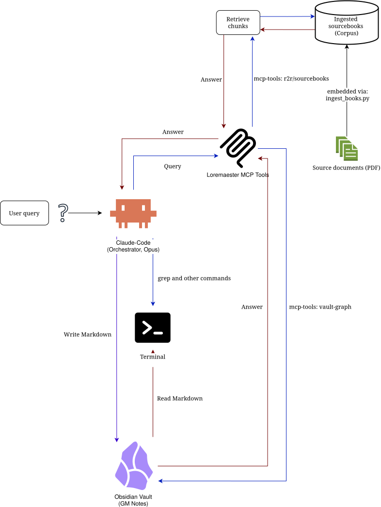

<h1 align="center">Loremaester</h1>

<p align="center"><em>A worldbuilding assistant for Claude Code</em></p>

<p align="center">
  
</p>

**Half your canon is on a shelf of scanned PDFs you can't search.
The other half is in an Obsidian vault Claude can't fully navigate.
This fixes both.**

A Claude Code setup that turns your Obsidian campaign vault and your
TTRPG sourcebooks (yes, scanned ones) into a single, citable,
wikilink-walkable knowledge base, then ships four GM-workflow skills
that use it: `worldbuilding`, `session-creation`, `chronik`,
`vault-scout`.

> **Run the 30-minute demo on the bundled Grunvyr campaign** →
> [docs/demo-walkthrough.md](docs/demo-walkthrough.md)

## What you get

1. **Keep your story straight: cross-reference your vault and your scanned sourcebooks in one prompt, end-to-end.** Claude:
    - reads your vault as canon (walking your wikilink graph via the `vault-graph` MCP server)
    - queries sourcebooks via hybrid semantic + keyword search
    - drafts a new NPC / location / session consistent with both
    - writes it to the right vault folder with correct frontmatter and wikilinks, and refreshes the graph.

    No tool switching, no copy-pasting.

2. **Four opinionated GM skills (`worldbuilding`, `session-creation`, `chronik`, `vault-scout`) that auto-trigger on your prompts**

    Driving 14 MCP tools (`vault_graph`, `search_lore`, …) to draft Sessions, Locations, and NPCs that stay consistent with your campaign history.

3. **Drop a folder of PDFs (text-native, mixed, or image-only) and walk away.** 

    The bulk ingester:
    - auto-classifies each PDF
    - routes text-native straight to R2R, OCRs scanned ones per-page with `pypdfium2` + `tesseract` (CPU default) 
    - or opt-in **EasyOCR on CUDA** (auto-falls back if no GPU)
    - and skips books already ingested.
  
    Stored in PostgreSQL + pgvector; retrieved via R2R's **hybrid semantic + keyword search with reciprocal rank fusion (RRF)**.

4. **Hardened by default.** 

    - Default-DROP egress firewall with a small allowlist (GitHub, npm, PyPI, Anthropic); VS Code Server telemetry disabled
    - Container images pinned to SHA256 digests (devcontainer base + the full compose stack)
    - Docker-default seccomp
    - Agent runs unprivileged.
    
    Threat model and design rationale: [`.devcontainer/SecurityReview.md`](.devcontainer/SecurityReview.md).

5. **Bring your own Obsidian vault, or start with the bundled `Grunvyr_Campaign` scaffold.**
    - From `git clone` to a playable session in 30 minutes.
    - The [demo walkthrough](docs/demo-walkthrough.md) ships three sourcebooks (one image-only as the OCR exhibit), an empty campaign vault, and six prompts that exercise every layer end-to-end.

## Retrieval is a tool here, not the product

Most RAG systems make the LLM a prisoner of the retriever. **Loremaester makes retrieval a tool the LLM chooses to use.**

Classic RAG caps answer quality at whatever the embedding model coughs up in one shot. If the search misses, the generator hallucinates confidently over bad context. The LLM has no agency over what it sees.

Here, it flips. Claude Code sits above the retrieval layer as planner, reasoner, and writer. R2R is a leaf tool it calls, alongside direct file reads (`Grep`/`Read` over the GM's vault canon) and a human-authored wikilink graph. The agent decides when to search, what to search, and whether the result is good enough. It can pull from the vault graph, ask a clarifying question, write a new canonical note, and rebuild the graph.

Retrieval recall stops being the ceiling. Reasoning is. And the system gets more trustworthy over time: every synthesis loop writes structured, human-reviewed canon back into the vault. The knowledge base compounds instead of drifting.

Vector search is necessary. It was never sufficient. This is what it looks like to treat it that way.

> For the broader "persistent-wiki" pattern that names this neighborhood, see Andrej Karpathy's [LLM Wiki gist](https://gist.github.com/karpathy/442a6bf555914893e9891c11519de94f). This repo is an independent, domain-specific implementation that predates it; see [ATTRIBUTION.md](ATTRIBUTION.md) for the full provenance. A general-purpose agent-loop sibling in adjacent territory: [`claude-obsidian`](https://github.com/AgriciDaniel/claude-obsidian). 🎩

## See it in 30 minutes

You don't need your own vault or sourcebook collection to evaluate this. The repo ships a complete working demo: three Grunvyr sourcebooks (one image-only as the OCR proof point), an empty `Grunvyr_Campaign` vault scaffold, and six demo prompts that exercise every layer of the system. **From `git clone` to ready-to-play session prep in your vault: about 30 minutes. The assistant does the toil; you review and run the table.**

What the six prompts prove:

| # | Prompt | What it proves |
|---|---|---|
| A | List the books, then search the Emberdeeps. | Multi-book hybrid search with `book_title` + `page_range` citations. |
| B | Summarize Volume III. | OCR ingestion of the image-only sourcebook (per-page hybrid, pypdfium2 + tesseract). |
| C | Draft a master-smith NPC for `Grunvyr_Campaign`. | The `worldbuilding` skill fuses vault canon + sourcebook research and writes a frontmatter-correct note. |
| D | Prepare Session 1 using the 8 Steps of the Lazy DM. | `session-creation` orchestrates vault + sourcebook + brainstorming into a Lazy-DM session folder. |
| E | Tabulate every NPC by name, faction, level. | `vault-scout` dispatches Haiku for the mechanical sweep so the main agent stays on judgment work. |
| F | Update the Campaign Chronicle from player notes. | `chronik` preserves who-told-whom-what across NPC interactions (information-exchange matrix). |

Full walk-through, including host prereqs and verification steps: [`docs/demo-walkthrough.md`](docs/demo-walkthrough.md).

## What's inside

### Architecture

<p align="center">
  
</p>

R2R runs on the host (heavy services: pgvector, optionally Unstructured.io + Hatchet for Full Mode); Claude Code runs in a hardened devcontainer with MCP servers reaching R2R over the docker bridge via `host.docker.internal:7272`. Full component rationale in [`docs/design.md`](docs/design.md).

### 3 MCP servers, 14 tools

> **Full per-tool reference** (parameters, returns, and internals): [`docs/mcp-tools.md`](docs/mcp-tools.md).

| Server | Tools | Role |
|---|---|---|
| **`r2r`** | `search`, `ingest_document`, `list_documents`, `delete_document`, `list_collections` | Generic CRUD + search against R2R. |
| **`sourcebooks`** | `search_lore`, `list_books`, `get_chapter` | Worldbuilding-aware lore queries with `book_title` / `chapter` / `page_range` citations. |
| **`vault-graph`** | `vault_graph`, `vault_backlinks`, `vault_search_notes`, `vault_central_notes`, `vault_reload_cache`, `vault_rebuild_graph` | Obsidian `[[wikilink]]` graph navigation and refresh. |

### 4 Claude Code skills

| Skill | What it does | When it fires |
|---|---|---|
| **`worldbuilding`** | Gathers vault context + sourcebook lore, drafts a new NPC / location / faction with correct frontmatter and `[[wikilinks]]`, writes it back, rebuilds the graph. Vault canon outranks sourcebook lore. | Any "create X" / "add Y" worldbuilding request. |
| **`session-creation`** | Orchestrates a Lazy DM session prep using the 8 Steps + Situations Checklist per scene. Writes a session folder with the main note and per-scene Encounter notes. | "Prepare Session N…" |
| **`chronik`** | Updates the Campaign Chronicle from player notes, preserving a who-told-whom-what exchange matrix so the campaign record stays auditable. | "Update the chronicle from session N's notes." |
| **`vault-scout`** | Dispatches mechanical sweeps (frontmatter collection, tabulation, scans) to Haiku, keeping the main agent on judgment work and token cost low. | "Tabulate every NPC by faction and level." |

Each skill auto-triggers on matching prompts and orchestrates the MCP tools above. No manual invocation.

### OCR pipeline

`scripts/ingest_books.py` auto-classifies each PDF (text-native / mixed / image-only via `detect_pdf_type.py`) and routes by type. Text-native goes straight to R2R. Mixed and image-only run through `scripts/ocr_extract.py`: per-page hybrid extraction with `pypdfium2` for page rendering, then `tesseract` (CPU default) or opt-in `EasyOCR` on CUDA (with auto-fallback to tesseract if no usable GPU is present). Embedded figure regions are OCR'd separately and appended to the page text. Already-ingested books are reported SKIPPED, so re-runs are safe and idempotent.

### Hardened devcontainer

`.devcontainer/init-firewall.sh` configures a default-DROP egress firewall with a small allowlist (GitHub, npm, PyPI/uv, Anthropic); host access is scoped to the docker-bridge gateway on ports `7272` (R2R) and `11434` (Ollama) only. Docker-in-Docker was deliberately removed (incompatible with the host-R2R networking AND it would gut the sandbox); the only Linux capability granted is `NET_ADMIN`, used by the firewall, not Docker. The agent shell runs as the unprivileged `node` user; PID 1 runs as root only long enough to apply iptables rules. Full threat model and design rationale: [`.devcontainer/SecurityReview.md`](.devcontainer/SecurityReview.md).

### Multi-instance deployment

Run multiple isolated R2R instances on one host (e.g., one for your campaign vault, one for a coding-research vault) via `docker/scripts/r2r-infra.sh` (shared Postgres + MinIO) and `docker/scripts/r2r-instance.sh <name> up` (per-vault R2R + dashboard). Each instance gets its own Postgres schema, port range, and TOML config. See `docker/instances/` for examples.

## Quickstart

```bash
# 1. Pull the embedding model and start Ollama (on the host)
ollama pull mxbai-embed-large && ollama serve

# 2. Start R2R in Light Mode (Full Mode + Unstructured.io: see docs/quickstart.md)
docker compose -f docker/compose.yaml --profile postgres --profile minio up -d

# 3. Build your vault graph (inside the devcontainer)
uv run --no-project scripts/build_vault_graph.py /path/to/vault

# 4. Install MCP dependencies (inside the devcontainer)
pip install -r requirements.txt

# 5. Configure MCP servers in .claude/settings.json (see docs/quickstart.md)
```

Full setup with your own vault and sourcebooks: [`docs/quickstart.md`](docs/quickstart.md). Or run the [bundled demo](docs/demo-walkthrough.md) first if you want to see it work end-to-end (about 30 minutes).

## What's not included (yet)

This is a v0.1 release. The honest gaps:

- **Windows hosts.** Linux and macOS are the supported and validated platforms for v0.1. The Ollama install path and `host.docker.internal` networking diverge on Windows and haven't been tested.
- **Non-TTRPG domain adaptation.** The `sourcebooks` MCP server's metadata schema (`book_title` / `chapter` / `page_range`) and the worldbuilding skill template assume TTRPG vocabulary. Adapting to other domains (legal, engineering, academic) is on the v0.2 roadmap.
- **End-to-end collection scoping.** The generic `r2r` MCP wrapper supports `collection_ids`, but the `sourcebooks` server and the `ingest_books.py` / `verify_ingestion.py` CLIs don't yet scope by collection. Per-corpus isolation needs this wiring; tracked as R-3 in [`specs/v0.2/specs_v0.2.md`](specs/v0.2/specs_v0.2.md).

## Contributing & community

- **[Contributing guide](CONTRIBUTING.md):** workflow, testing standards, what we will and won't merge.
- **[Code of Conduct](CODE_OF_CONDUCT.md):** Contributor Covenant v2.1.
- **[Security policy](SECURITY.md):** how to report a vulnerability privately.
- **[Attribution](ATTRIBUTION.md):** credits for the software this project builds on, plus the convergent-design note on Karpathy's LLM Wiki pattern.

## License

This project's own code is released under the **MIT License**. See [LICENSE](LICENSE).

It orchestrates third-party components that retain their own licenses, notably [R2R](https://github.com/SciPhi-AI/R2R) (MIT). The client-side OCR stack is fully permissive: tesseract/pytesseract (Apache-2.0), pypdfium2 (Apache-2.0/BSD-3), and the optional GPU path easyocr (Apache-2.0) with torch (BSD-3).

See [`THIRD_PARTY_NOTICES.md`](THIRD_PARTY_NOTICES.md) for full attribution and important usage notes before redistributing or hosting this project.
