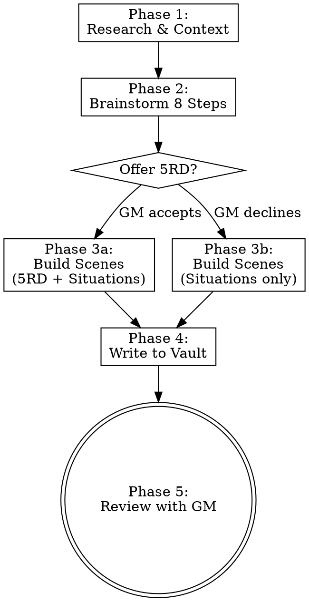

# Session Creation Assistant

Orchestrate new session preparation by combining three RPG prep methodologies:
- **8 Steps of the Lazy DM** — the skeleton (mandatory template)
- **5 Room Dungeon** — scene architecture (offered as option)
- **Situations Checklist** — scene content (always applied)

**REQUIRED SKILLS:** `/worldbuilding` for vault navigation and sourcebook research, `brainstorming` (superpowers) for collaborative refinement.

## Workflow



### Phase 1: Research & Context

Use `/worldbuilding` Step 1 + Step 2 to gather context before brainstorming.

1. **Determine next session number**: List `Sessions/Session *` folders, find highest N, use N+1. Always increment, never fill gaps.
2. **Read recent sessions**: Last 1-2 session main files, focusing on `## Log` and `## Open Threads` for outstanding plot threads.
3. **Read PlayerNotes**: `PC/PlayerNotes/` — source of truth for what actually happened to the PCs from the players' perspective. Names may be phonetic or misspelled; cross-reference against canonical vault notes.
4. **Check in-game date** (if the vault tracks one): some vaults use a calendar plugin and store events at `.obsidian/plugins/<calendar-plugin>/data.json`. If present, search for the next in-game date and any upcoming events.
5. **Map vault connections**: `vault_graph()`, `vault_backlinks()`, `vault_search_notes()` on active NPCs, locations, factions from recent sessions.
6. **Research sourcebooks**: `search_lore()` and `get_chapter()` for published material relevant to upcoming content.
7. **Summarize** findings for the GM: open threads, active NPCs, current date/location, relevant sourcebook material.

### Phase 2: Brainstorm the 8 Steps

Use the brainstorming skill to work through the Lazy DM template collaboratively. The template structure is mandatory — never skip steps.

| Step | Focus | Key Action |
|------|-------|------------|
| 1. Review Characters | PC hooks | Read PC notes, ask: "What hook draws this character in?" |
| 2. Strong Start | Opening scene | Craft an in media res opening with read-aloud text |
| 3. Scenes | Scene list | **Phase 3 feeds in here** — build scenes with frameworks below |
| 4. Secrets & Clues | 8-10 discoverable facts | Keep abstract from locations; can be revealed anywhere |
| 5. Fantastic Locations | Evocative places | Link to existing `type: place` notes or create new ones via /worldbuilding |
| 6. Important NPCs | Key characters | Link to existing `type: NPC` notes or create new ones via /worldbuilding |
| 7. Relevant Monsters | Encounters | Stat blocks, encounter levels, system reference links |
| 8. Loot | Rewards | Level-appropriate items, narrative significance |

### Phase 3: Build Scenes

Two frameworks are available. The **Situations Checklist** is always applied. The **5 Room Dungeon** is offered as an option — present it to the GM and let them decide.

#### 5 Room Dungeon (offered as option)

Present this mapping to the GM: *"Would you like to structure this session's arc using the 5 Room Dungeon framework? 'Rooms' are story beats — they work for dungeons, wilderness, social, or political sessions alike."*

| Room | Purpose | Examples |
|------|---------|---------|
| 1: Entrance & Guardian | Set mood, immediate action, threshold | Ambush, locked gate, hostile patrol, social gatekeeper |
| 2: Puzzle / RP Challenge | Change pace, foreshadow climax | Riddle, NPC negotiation, environmental puzzle, investigation |
| 3: Trick / Setback | Build tension, complicate | Betrayal, trap, false victory, reinforcements arrive |
| 4: Climax | Main conflict, highest stakes | Boss fight, tense negotiation, race against time |
| 5: Reward / Revelation | Wrap up, set future hooks | Treasure, plot twist, new information, moral choice |

If the GM accepts, map each scene to a Room number. Not every session needs all 5 rooms — 3-4 is fine.

#### Situations Checklist (always applied)

Every scene must have at minimum **Location + Inhabitants + Goal**. Fill out as many elements as relevant:

| Element | Question | Guidance |
|---------|----------|----------|
| **Location** | What is this place? | Multiple paths/entrances so players have choice. Link to or create `type: place` note. |
| **Inhabitants** | Who is here? | Mix intelligent + unintelligent creatures. Include friendly NPCs (turncoats, allies, spirits). |
| **Factions** | What groups have stakes here? | 2-3 factions with conflicting interests players can exploit. |
| **Goal** | Why are the PCs here? | Clear motivation driving the characters into this situation. |
| **Complications** | What shakes things up? | Dynamic events: timers, reinforcements, environmental shifts, rituals completing. |
| **Secrets & Clues** | What can be discovered? | Tied to location history, faction goals, or broader campaign arcs. |

### Phase 4: Write to Vault

Use `/worldbuilding` Step 4 for all file creation.

**Folder structure:**
```
Sessions/Session N/
  YYYY-MM-DD Session N.md          <- Main file (type: session)
  Scene Name 1.md                  <- type: Encounter
  Scene Name 2.md                  <- type: Encounter
  New Location Name.md             <- type: place (if needed)
```

**Main session file** — based on `templates/Session Preparation.md`:
```yaml
---
type: session
world: <vault world>
campaign: <vault campaign>
date: YYYY-MM-DD          # real date
game_date: YYYY-MM-DD     # in-game date (if tracked)
location: ""
characters: ["[[PC One]]", "[[PC Two]]", "[[PC Three]]"]
tags: [session]
---
```
- Fill all 8 steps from Phase 2
- Scenes section: `- [ ] [[Scene Name]]` checklist linking to sub-files
- Include `## Log` section (empty, filled during play)

**Scene sub-files** (type: Encounter):
```yaml
---
type: Encounter
aliases: []
world: <vault world>
campaign: <vault campaign>
date: YYYY-MM-DD
date_ingame: []
pc: []
npc: []
---
```
Sections: `## Background`, `## Description` (read-aloud in blockquotes), `## NPCs & Stats`, `## Further Developments`

**New NPC/Location notes**: Create via `/worldbuilding` with proper frontmatter and folder placement (`NPC/`, `Locations/`).

**After all files are written:**
- Ensure every reference to a known entity uses `[[wikilinks]]`
- Update related notes with backlinks (ask GM before modifying existing notes)
- Call `vault_rebuild_graph()` so the new files appear in the wikilink index

### Phase 5: Review

Present to the GM:
1. Complete folder structure with all created files
2. If 5RD was used: which scenes map to which rooms
3. Situations checklist coverage per scene
4. All `[[wikilinks]]` created (new notes + existing notes referenced)
5. Any decisions or open questions

Ask if adjustments are needed before finalizing.

## Rules

- **8 Steps template is mandatory** — every session gets all 8 steps filled out
- **5RD is always offered, never forced** — GM decides per session
- **Situations minimum: Location + Inhabitants + Goal** per scene
- **Canon hierarchy**: Vault > sourcebooks (from /worldbuilding)
- **Match the vault's existing voice and style** — read a few existing notes to calibrate tone
- **Headers**: Use template style (`Step 1:`, `Step 2:`, etc.)
- **Never overwrite** existing session folders or notes
- **Always ask** before modifying existing vault notes
- **Session numbering**: Always max(N)+1, never fill gaps
