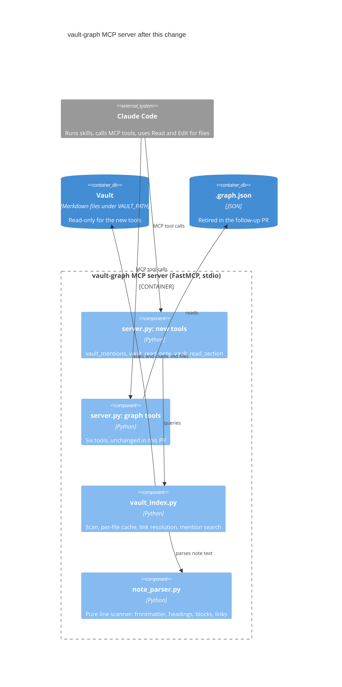

# Surgical vault search: mentions and section reads

> Spec for branch `surgical-search`. Status: **draft for review**, revised after an independent review
> (2026-10-18). Milestone: `v0.2` (see D11).
> Method: EARS requirements with RFC 2119 keywords, a C4 component view, and every requirement (R#)
> traced to a verification (V#). Implementation steps (S#) live in `tasks/todo.md`, one TDD slice per
> test, each naming the R#s it covers (see D13 and V1).

## 1. Context

### Problem

Vault work in loremaester reads Markdown notes whole, which fills the context window. Three causes:

1. No vault tool returns note content. `vault_backlinks` returns names and paths only, and the graph
   index (`.graph.json`) keeps link targets without lines, headings or text.
2. The skills prescribe whole reads: worldbuilding follows wikilinks "1-2 levels deep", chronik reads
   "every sub-file" of a session folder and every referenced NPC note, and the vault CLAUDE.md template
   says to Grep for backlinks and Read to traverse.
3. `vault-scout` works around it by sending the reading to a Haiku subagent, which moves the cost
   instead of removing it.

### Goal

Give Claude Obsidian-style **linked and unlinked mentions** (the block around each mention, grouped by
note) and **section reads**, so skills pull only the parts of notes they need. Whole reads become the
last resort.

The workflows that hurt: (a) worldbuilding research around hub notes, and (b) chronik and session prep
reading linked notes. Ad-hoc lookups (c) work well today and keep their freedom.

### Baseline

Measured read-only on a real 469-note campaign vault (backup snapshot, its two skip folders applied,
tokens estimated as characters divided by 4, the linked-mode rules of section 6 simulated by a script):

| Measure | Value |
|---|---|
| Note size | median ~680 tokens; 77% under 2k; largest ~22k (player notes with a single heading) |
| Biggest hub (76 linking notes, 294 mentions) | ~217k tokens read whole; ~20k for every excerpt; first call ~4.8k (excerpts from 16 notes across all 7 folders, plus a map of the rest) |
| Linked mentions per note | 302 of 334 linked notes (90%) fit all their excerpts in 4k tokens; 286 (86%) need no map, because for 16 others the 1,500-character cut moves a mention to the map. Since the R48 amendment trims instead of cutting, all 302 need no map (V4, 2026-10-20) |
| Excerpts over 1,500 characters | 39 of 5,567 across all answers (21 distinct blocks); 26 of 6,046 mentions move to the map. After the R48 amendment, none do: across every note as a target, 38 linked excerpts are trimmed and 2 come in parts (V4, 2026-10-20) |
| Unlinked mentions | heavier: ~49k tokens of excerpts for each of the top two hubs |
| Notes linked from each of the 5 latest session folders | 8 to 55 notes; 19k to 134k tokens read whole; 3 to 6x less when small notes are read whole and large ones as an outline plus one section |
| Cold parse of the whole vault | about 0.4 s |

The same survey found defects in the graph tools, handled outside this spec (section 9): backlinks are
listed once per link instead of once per note, exact file-name matching misses 68 links that Obsidian
resolves, 4 file names occur twice, and the index was 22 notes behind the vault.

### Success criteria

- **SC1** No mention is hidden: every `vault_mentions` response accounts for every matching mention,
  shown in an excerpt or listed in the map.
- **SC2** On the measured vault, the first `vault_mentions` call for the biggest hub stays near 5k
  tokens and reaches every folder with mentions, and at least 8 in 10 linked notes fit all their linked
  mentions in one call at the default budget.
- **SC3** In a side-by-side run of the same chronik or session-prep task, the new skills use at least
  3x less context than the old ones, and the GM judges the result at least as good.

## 2. Tier

**Heavy.** A new subsystem (a parser and an index behind three new MCP tools) plus behavior changes in
four skills.

## 3. Decisions

| # | Decision | Outcome | Why |
|---|---|---|---|
| D1 | Scope | Linked and unlinked mentions, plus note and section reads. No previews of linked notes, no write tools. | The cost is in reading; edits stay visible diffs through Edit. |
| D2 | Excerpt unit | The Markdown block holding the mention, labelled `path:line › heading path`; for a heading, the heading plus its first block | Mirrors Obsidian's Linked Mentions; keeps a list item's sub-items and a table's header. A whole section would crowd out other mentions. |
| D3 | Large results | The budget limits excerpt text only; when not everything fits, no note takes more than a quarter of it, or an even share when fewer than four notes have mentions; an excerpt over 1,500 characters is trimmed to its mentions, so every mention fits in some excerpt; a map lists every mention the budget leaves out; `paths` pulls chosen folders or notes | Nothing is lost by design, one heavy note cannot crowd out the rest, and Claude pulls only what it needs. |
| D4 | Unlinked matching | Title and aliases, case-insensitive whole words, optional configured endings | Obsidian behavior, plus inflected languages through a setting; the default stays generic. |
| D5 | Ordering | Folders take turns; reverse natural path order inside a folder | Breadth first; numbered or dated sessions come newest first without special folder names. Order only decides what shows first, since the map lists the rest. |
| D6 | Index | A live per-file cache for the new tools; the graph tools move in a follow-up PR | No rebuild step and never stale; lets the follow-up retire `vault_rebuild_graph`. |
| D7 | Parser | Our own line scanner, no new dependency | The block model is line-based, and vault notes rarely need full CommonMark. |
| D8 | Read policy | A read ladder in the skills; whole reads only for named exceptions; no enforcing hook | The skills drive the costly workflows; ad-hoc use keeps its freedom. |
| D9 | `vault_read_note` | Whole under ~2k tokens; above that, an outline with the frontmatter and the lead | For a small note, an outline plus a section costs about as much as the note; Claude never guesses sizes. |
| D10 | Skills | Repo skills change here, in generic English; the maintainer's personal copies are compared side by side after merge | Release files stay generic; the behavior is verified on real prep. |
| D11 | Milestone | `v0.2`, amending locked decision Q1 (security plus backlog) by this one feature; confirmed by the GM on 2026-10-18 | v0.2 has not started, and the follow-up removes `vault_rebuild_graph` instead of gating it (SEC-5). |
| D12 | Aliases | Links resolve by file name and path, as in Obsidian. A `note` argument also resolves by alias, and links written as an alias count as mentions of the aliased note. | Claude often knows a note by another name, and links that name an alias would otherwise drop out of every view. |
| D13 | Tests | One test per behavior: requirements that describe one behavior share a test, requirements no test can fail are inspected, and each test is its own TDD slice | Keeps one test per RED/GREEN cycle without slices that test nothing new. |

## 4. Architecture

### 4.1 Component view (C4 level 3)



### 4.2 Components

| Component | Exposes | Depends on | Requirements |
|---|---|---|---|
| `note_parser.py` (new) | `parse_note(text)`: frontmatter, aliases, headings, code spans, links with lines, the lead; block, context lines, section and heading path for a line | Standard library, PyYAML (already in `requirements.txt`) | R16-R31, R48 |
| `vault_index.py` (new) | `VaultIndex`: refresh, resolve (file names, paths, aliases), linked and unlinked mentions, where a mention starts on a line | `note_parser.py`, the file system (read-only) | R1-R12, R14, R32-R40, R52-R57, R91 |
| `server.py` (changed) | The three new MCP tools; the six graph tools unchanged | `vault_index.py` | R13, R15, R41-R51, R58-R80, R90, R91 |
| Skills, examples, docs (changed) | The read ladder and the tool reference | The three tools | R81-R89 |

### 4.3 Data flow of `vault_mentions`

1. Refresh: stat every `.md` file, re-parse added or changed notes, drop deleted ones.
2. Resolve the `note` argument by file name, path or alias, or treat the name as an unwritten note.
3. Collect mentions: links that resolve to the note or name one of its aliases, or plain-text matches in
   unlinked mode.
4. Build the block for each mention, merge overlapping blocks per note, trim excerpts over 1,500
   characters to their mentions and context lines (in parts when still too long, and with a window
   around the mention on a line too long by itself), and label them.
5. Order the notes: folders take turns, reverse natural order inside a folder.
6. Fill excerpts up to the budget (when not everything fits, each note takes at most a quarter of it, or
   an even share when fewer than four notes have mentions); put every mention no excerpt shows in the map.
7. Format Markdown: overview, excerpts, map, pull hints.

### 4.4 Configuration

| Variable | Default | Meaning |
|---|---|---|
| `VAULT_PATH` | `/workspace/vault` | Vault root (existing). |
| `VAULT_SKIP_FOLDERS` | empty | Comma-separated vault-relative folders whose notes are not listed as mention sources. They are still counted in the overview and reachable through `paths`. |
| `VAULT_NAME_ENDINGS` | empty | Comma-separated suffixes for unlinked matching, for example `s,es,n,en,e,er,ern` for German. |

## 5. Tool contracts

All three tools take `note` the way a link names a note, or by one of its aliases (section 6.5), and
return Markdown. They name the vault root once and show every other path relative to it, so Claude can
turn `path:line` into a `Read` with offset and limit.

### 5.1 `vault_mentions(note, unlinked=False, paths=None, budget_tokens=4000)`

```text
## Linked mentions: Captain Aldric (NPCs/Captain Aldric.md)
Vault: /path/to/vault
76 notes link here: Sessions 31 · Locations 23 · NPCs 19 · (root) 3
Unlinked: 64 notes name it without a link
Skipped folders: Rules 2
Excerpts for 16 notes (~4.0k of ~20k tokens for all)

Sessions/Session 36/Prep.md:42 › Scenes › Arrival
- The party meets [[Captain Aldric]] at the north gate.
  - He asks about the missing patrol.

Locations/North Gate.md:31 › Residents
| Name | Role |
|---|---|
…
| [[Captain Aldric]] | Gate captain |

Sessions/Session 35/Log.md:12 › Day 2
## [[Captain Aldric]] returns
…
- At the council:
…
  - [[Captain Aldric]] names the deserters.
…
- [[Captain Aldric]] rides north at dawn.
[trimmed to its mentions; the block runs L12-61]

...

Not shown, pull with paths=[...]:
Sessions (23): Sessions/Session 12/Log.md L40,88 · ...
Locations (19): Locations/Old Mill.md L12 · Locations/Ferry.md L3,19 · ...
More: paths=["<folder or note>"] · budget_tokens=<n> · unlinked=true
```

### 5.2 `vault_read_note(note)`

A note under ~2k tokens comes back whole:

```text
## NPCs/Mira.md (~640 tokens, whole)
Vault: /path/to/vault
---
type: npc
...
```

A larger note comes back as an outline. The frontmatter and the lead come verbatim, each cut at 1,500
characters; heading ranges include their subsections:

```text
## Outline: NPCs/Captain Aldric.md (212 lines, ~3.1k tokens)
Vault: /path/to/vault
Frontmatter, L1-4:
  type: npc
  aliases: [Aldric, the Captain]
Lead, L7-8:
  Captain of the north gate since the flood.
  Loyal to the council, wary of the party.
Headings:
  L6-212    # Captain Aldric    ~3.0k
  L10-60    ## Background       ~0.9k
  L61-140   ## Relationships    ~1.4k
  L95-140     ### Rivals        ~0.6k
  L141-212  ## GM Notes         ~1.0k
```

A large note without sections to pick from says so:

```text
## Outline: Players/Notes.md (900 lines, ~22.4k tokens)
Vault: /path/to/vault
Lead, L2-900:
  ...
  [cut at 1,500 characters; the lead ends at L900]
No sections to pick from (one heading).
For specific names: vault_mentions("<name>", paths=["Players/Notes.md"])
For all of it: Read the file.
```

### 5.3 `vault_read_section(note, headings)`

```text
## NPCs/Captain Aldric.md:61-140 › Captain Aldric › Relationships (~1.4k tokens)
Vault: /path/to/vault
## Relationships
...
```

### 5.4 The read ladder

| Need | Step |
|---|---|
| What does the vault say about X? | `vault_mentions` |
| What is X? | `vault_read_note` |
| Which part of X? | `vault_read_section` |
| All of X | A whole `Read`, only for the exceptions below |

Exceptions where a whole `Read` is right: unstructured source material the task is about (for example
player notes without sections, which chronik treats as the source of truth), and a note rewritten from
scratch. Edits read only the lines being changed: Claude Code accepts an Edit after a partial Read.

Skill changes:

- **worldbuilding**: the primary note through `vault_read_note`; linked notes through `vault_read_note`
  and sections instead of reading one or two link levels whole; `vault_mentions` instead of grepping for
  `[[Topic Name]]`. The grep for plain-text frontmatter fields stays.
- **chronik**: player notes whole (the exception). For each NPC they name,
  `vault_mentions(npc, paths=["Sessions/Session N"])` for what that session's prep says about them, and
  `vault_read_note(npc)` for who they are. Prep files through `vault_read_note` and sections.
- **session-creation**: `vault_read_section(session, ["Log", "Open Threads"])` for recent sessions;
  `vault_mentions` for active NPCs, locations and factions.
- **vault-scout**: Example 3 uses `vault_mentions`; the tool list gains the three tools; mentions and
  sections of one note are no longer a reason to dispatch.

The graph tools and the skills' `vault_rebuild_graph()` calls stay until the follow-up PR. vault-scout's
warning that the index may be stale applies to the graph tools only; the new tools read the vault live.

## 6. Requirements

### 6.0 Terms

| Term | Meaning |
|---|---|
| Listed notes | The notes a `vault_mentions` call may list: the notes `paths` covers when given, else all notes. Notes in a skipped folder are left out unless a `paths` entry matches that folder or something inside it. |
| Token estimate | Characters divided by 4. |
| Blank line | A line holding only spaces or tabs. |
| Heading | A line that starts with 1 to 6 `#` followed by a space or tab. A `#tag` at the start of a line is not a heading. |
| List item | A line whose first non-space text is `-`, `*` or `+`, or digits followed by `.` or `)`, then a space or tab. |
| Table row | A line whose first non-space character is `\|`. |
| Quote line | A line whose first non-space character is `>`; callouts are quote lines. |
| Context line | A line above a mention that frames it: the first row and separator row of its table, the first line of its quote run, the first line of each ancestor item and of the item a continuation line belongs to, and the key line of its frontmatter property. |
| Fence | A line whose first non-space text is three or more backticks or tildes. It opens a code block that the next fence with the same character closes. |
| Thematic break | A line of three or more `-`, `*` or `_`, optionally separated by spaces, and nothing else. |
| Lead | The lines after the frontmatter and before the first heading; or, when the first non-blank line after the frontmatter is a level-1 heading, the lines between it and the next heading. |
| Shown | A mention is shown when its line appears in an excerpt of the response. |
| Path match | A `paths` entry matches a folder or note whose vault-relative path equals the entry or ends with it at a folder boundary, compared as in R32, with `.md` optional. |
| Close names | For an unknown name: the titles and aliases that contain it (shortest first), then those with a `difflib` similarity ratio of at least 0.6 (highest first), compared as in R32. |

### 6.1 Configuration

- **R1** The new tools SHALL use the vault root from `VAULT_PATH`, defaulting to `/workspace/vault` like
  the graph tools.
- **R2** Where `VAULT_SKIP_FOLDERS` names folders, `vault_mentions` SHALL NOT list mentions from notes
  inside them.
- **R3** When a `paths` entry matches a skipped folder or something inside one, `vault_mentions` SHALL
  list mentions from the notes that entry covers.
- **R4** `vault_read_note` and `vault_read_section` SHALL open notes inside skipped folders.
- **R5** Where `VAULT_NAME_ENDINGS` lists suffixes, unlinked matching SHALL also match a term followed by
  exactly one of them.
- **R6** While `VAULT_SKIP_FOLDERS` and `VAULT_NAME_ENDINGS` are unset or empty, the server SHALL skip no
  folder and match no ending.

### 6.2 Index, safety and output

- **R7** The index SHALL include every `.md` file under the vault root except files with a path segment
  that starts with `.` (such as `.obsidian` and `.trash`).
- **R8** If a file's real path lies outside the vault root, then the index SHALL NOT read it.
- **R9** When a new tool is called, the index SHALL reflect every note added, changed (modification time
  or size) or deleted since the previous call.
- **R10** The index SHALL NOT re-read a note whose modification time (in nanoseconds) and size are
  unchanged.
- **R11** The index SHALL decode notes as UTF-8, replacing invalid bytes.
- **R12** The tools SHALL match `note` and `paths` arguments against the scanned notes and SHALL NOT open
  a path built from an argument.
- **R13** The new tools SHALL NOT create, modify or delete any file.
- **R14** The new tools SHALL work when `.graph.json` is missing.
- **R15** Every response of the new tools SHALL name the vault root once and show all other paths
  relative to it.

### 6.3 Parsing

- **R16** Where a note's first line is `---` and a later line is `---`, the parser SHALL treat the lines
  between them as frontmatter.
- **R17** If the frontmatter is not valid YAML, then the parser SHALL keep its text and report no
  aliases.
- **R18** The parser SHALL read aliases from the frontmatter keys `aliases` and `alias`, each given as a
  list or a single string.
- **R19** The parser SHALL recognize headings (6.0) only outside code and frontmatter; underlined
  (setext) headings stay plain text.
- **R20** The parser SHALL find no links and no unlinked mentions inside fenced code blocks (6.0) or
  inline code.
- **R21** The parser SHALL recognize `[[target]]`, `[[target|text]]`, `[[target\|text]]` (the escaped
  form used in tables), `[[target#heading]]`, `[[target#^block]]` and `![[target]]` as links to
  `target`, in the body and in frontmatter values.
- **R22** The parser SHALL NOT count as links: `[[#heading]]` links within a note, links whose target
  ends in an attachment extension (`avif`, `bmp`, `gif`, `jpeg`, `jpg`, `png`, `svg`, `webp`, `flac`,
  `m4a`, `mp3`, `ogg`, `wav`, `3gp`, `mkv`, `mov`, `mp4`, `ogv`, `webm`, `pdf`, `canvas` or `base`, in
  any case), and Markdown-style `[text](path)` links. Targets such as `Dr. Smith` or `Session 3.5` stay
  links.

### 6.4 Blocks and sections

- **R23** For a mention in a paragraph, the block SHALL be the run of adjacent non-blank lines that are
  not headings, list items, table rows, quote lines, fences or thematic breaks.
- **R24** For a mention in a list item, the block SHALL be the item plus the run of following lines
  indented deeper than it (a tab counts as four columns), ending at the first blank line or the first
  line that is not indented deeper.
- **R25** For a mention in a nested list item, the block SHALL also include the first line of each
  ancestor item, found as the nearest item above with less indentation, repeated upward.
- **R26** For a mention in a table row, the block SHALL be the table's first row, its separator row if
  present, and the mentioning row.
- **R27** For a mention in a callout or blockquote, the block SHALL be the whole run of adjacent `>`
  lines.
- **R28** For a mention in a heading, the block SHALL be the heading line plus the lines from the next
  non-blank line below it up to, not including, the next blank line or heading.
- **R29** For a mention in frontmatter, the block SHALL be the property: its key line plus its indented
  or list continuation lines.
- **R30** A section SHALL run from its heading to the line before the next heading with the same or
  fewer `#`, or to the end of the note.
- **R31** The heading path of a block SHALL be the chain of headings enclosing its first line, joined by
  ` › `.

### 6.5 Link resolution

- **R32** The index SHALL compare names (link targets, `note` arguments, `paths` entries and aliases)
  after Unicode NFC normalization and lowercasing, ignoring surrounding whitespace and a trailing `.md`.
- **R33** A target without `/` SHALL match notes by file name without `.md`.
- **R34** A target with `/` SHALL match the vault-relative path from the root, or else the end of a path
  at a folder boundary.
- **R35** When several notes match a link target, the index SHALL pick the one in the linking note's
  folder, else the one with the fewest path segments, else the alphabetically first path.
- **R36** When no file name or path matches a `note` argument, the tools SHALL match it against the
  notes' aliases.
- **R37** When a `note` argument matches by alias, the response SHALL name the alias and the note it
  belongs to.
- **R38** When several notes match a `note` argument, the tool SHALL pick the one with the fewest path
  segments, else the alphabetically first path.
- **R39** When several notes match a `note` argument, the response SHALL name the other matches.
- **R40** When no note matches a link target, the index SHALL record the link as a mention of an
  unwritten note named by the normalized target.

### 6.6 `vault_mentions`: linked mode

- **R41** `vault_mentions` SHALL list every link in a listed note that resolves to the requested note.
- **R42** `vault_mentions` SHALL also list links whose target matches no note and equals one of the
  requested note's aliases.
- **R43** When the requested name matches no note by file name, path or alias, `vault_mentions` SHALL
  list the links recorded for that unwritten note.
- **R44** `vault_mentions` SHALL NOT list a note's links to itself.
- **R45** Each excerpt SHALL show its block under the label `path:line › heading path`, where `line` is
  the 1-based line of the excerpt's first mention.
- **R46** Blocks of one note that share a line SHALL appear as one excerpt, unless R90 splits it.
- **R47** An excerpt SHALL show a line `…` wherever it skips non-blank lines of the note.
- **R48** If an excerpt exceeds 1,500 characters, then the tool SHALL trim it to its mention lines and
  their context lines (6.0), mark the skipped lines as in R47, and end it with a marker naming the
  block's first and last line. (Amended 2026-10-20: the excerpt used to be cut at 1,500 characters, and
  no `paths` call could show the mentions after the cut.)
- **R90** If a trimmed excerpt still exceeds 1,500 characters, then the tool SHALL split its mentions, in
  line order, into as few consecutive parts as fit within the limit with their context lines; each part
  SHALL be its own excerpt, labelled as in R45 with the heading path of its first shown line, and its
  marker SHALL also name its part number and the number of parts.
- **R91** If a single mention line with its context lines exceeds 1,500 characters, then the tool SHALL
  shorten each context line over its share (200 characters, less when there are many) to its start
  and, if the excerpt still does not fit, the mention line to a window around the first mention on it,
  marking each shortened end with `…`, so that the excerpt fits within the limit.
- **R49** The response SHALL open with an overview: the note's path (or "no note yet"), the count of
  listed notes with mentions per top-level folder, and the count of listed notes with mentions of the
  other kind (unlinked in linked mode, linked in unlinked mode).
- **R50** Where skipped folders hold mentions that are not listed, the overview SHALL give the count of
  mentioning notes per skipped folder.
- **R51** The overview SHALL state how many notes have excerpts, and the estimated tokens shown against
  the estimated tokens of all excerpts.

### 6.7 `vault_mentions`: unlinked mode

- **R52** When `unlinked` is true, `vault_mentions` SHALL list plain-text occurrences of the note's title
  or aliases in other notes instead of links.
- **R53** Unlinked matching SHALL be case-insensitive and match whole words only: no letter, digit or
  underscore of any script directly before or after the match.
- **R54** Unlinked matching SHALL ignore titles and aliases shorter than 3 characters.
- **R55** Unlinked matching SHALL search body text only, excluding frontmatter, code, wikilinks,
  Markdown links and URLs.
- **R56** In unlinked mode, an occurrence inside a block that holds a link to the note SHALL NOT count
  as a mention.
- **R57** For an unwritten note, unlinked matching SHALL use the requested name as its only term.

### 6.8 Budget, map and paths

- **R58** Only excerpts and their labels SHALL count toward `budget_tokens` (default 4,000).
- **R59** While all excerpts together exceed the budget, the tool SHALL take each note's excerpts in line
  order only while they fit within the larger of a quarter of the budget and the budget divided by the
  number of listed notes with mentions. (Amended 2026-10-19: with a quarter alone, a `paths` call that
  lists one heavy note returned the same excerpts as the call before it and left three quarters of the
  budget unused.)
- **R60** The tool SHALL add the notes' excerpts in listing order and stop at the first note whose
  excerpts would exceed the remaining budget.
- **R61** The tool SHALL show at least one excerpt.
- **R62** After the excerpts, the response SHALL list every mention that is not shown in a map: note
  path and mention line numbers, grouped by top-level folder.
- **R63** When the map is not empty, the response SHALL end with pull hints for `paths`, `budget_tokens`
  and the other mode.
- **R64** For any `budget_tokens` and `paths`, every matching mention in listed notes SHALL be shown or
  in the map.
- **R65** Where `paths` is given, `vault_mentions` SHALL list only mentions from notes that an entry
  matches (6.0) or that lie inside a folder an entry matches.
- **R66** If a `paths` entry matches no note or folder, then the response SHALL say so.

### 6.9 Ordering

- **R67** `vault_mentions` SHALL let top-level folders take turns, the folder with the most mentioning
  notes first, ties by folder name, with notes at the vault root forming their own folder.
- **R68** Within a folder, `vault_mentions` SHALL order notes by vault-relative path in reverse natural
  order, comparing digit runs as numbers.

### 6.10 `vault_read_note`

- **R69** If a note's estimated size is under 2,000 tokens, then `vault_read_note` SHALL return the note
  whole.
- **R70** If a note's estimated size is 2,000 tokens or more, then `vault_read_note` SHALL return an
  outline: path, line count, estimated tokens, the frontmatter verbatim (cut at 1,500 characters with a
  marker), and each heading with its level, line range including subsections, and estimated tokens.
- **R71** The outline SHALL show the note's lead verbatim, cut at 1,500 characters with a marker.
- **R72** If an outlined note has fewer than two headings, then the outline SHALL say that sections
  cannot slice it and name `vault_mentions` with `paths` and a whole `Read` as the ways in.

### 6.11 `vault_read_section`

- **R73** `vault_read_section` SHALL accept one heading or a list of headings.
- **R74** `vault_read_section` SHALL match headings case-insensitively after trimming whitespace and `#`
  marks.
- **R75** `vault_read_section` SHALL return every matching section, each labelled with its path, line
  range and heading path.
- **R76** `vault_read_section` SHALL NOT truncate a matching section.
- **R77** If a requested heading matches no section, then the response SHALL list the note's headings.

### 6.12 Errors

- **R78** If `vault_read_note` or `vault_read_section` receives a `note` that matches no note, then it
  SHALL return an error naming up to five close names (6.0).
- **R79** If `vault_mentions` receives a name that matches no note, then the response SHALL name up to
  five close names (6.0).
- **R80** If the vault root is missing or not a folder, then each new tool SHALL return an error naming
  the path.

### 6.13 Skills, tool descriptions and docs

- **R81** The worldbuilding, chronik, session-creation and vault-scout skills SHALL route vault reading
  through the read ladder in 5.4.
- **R82** The skills SHALL reserve a whole-file `Read` for the exceptions in 5.4.
- **R83** The skills SHALL direct edits to `Read` only the lines being changed.
- **R84** The skill copies under `examples/ttrpg/skills/` SHALL stay byte-identical to `skills/`.
- **R85** Release files changed by this work SHALL contain no personal campaign names and no non-English
  prose.
- **R86** The new tools' descriptions SHALL say what each tool returns without forbidding `Read`.
- **R87** The vault CLAUDE.md example and template SHALL point to the new tools for mentions and large
  notes without forbidding `Read`.
- **R88** `docs/mcp-tools.md`, `README.md`, `docs/quickstart.md`, `CHANGELOG.md` and `docs/design.md`
  SHALL document the three tools, the two new settings and the tool count of 17.
- **R89** `docs/design.md` (its vault graph summary and its section on a pre-computed graph rather than
  runtime scanning) and `docs/mcp-tools.md` (its description of vault-graph as served from
  `.graph.json`) SHALL describe the new tools' live scan next to the graph tools' pre-computed index.

## 7. Verification

| V# | Method | Covers | Check |
|---|---|---|---|
| V1 | TEST | R2-R80 and R90-R91 except R13 | One pytest test per requirement, except that these pairs describe one behavior and share a test: R2+R50, R31+R45, R36+R37, R38+R39, R49+R51, R62+R63, R70+R71, R73+R75, R78+R79. R14 has no test of its own: the fixture vault has no `.graph.json`, so every test covers it. That makes 70 tests, each its own TDD slice; amendments and guards add further tests (R48, R59, R90 and R91 have more than one). Tests are named after their requirements (`test_r07_<behavior>`, `test_r36_r37_<behavior>`), live in `test_note_parser.py`, `test_vault_index.py` and `test_vault_tools.py` under `mcp-servers/vault-graph/`, and run against a small fictional fixture vault built in `tmp_path`. A check lists any requirement in R2-R80 or R90-R91 without a test, other than R13 and R14. |
| V2 | INSPECT | R1, R13, R81-R89 | R1: the new tools read the same `VAULT_PATH` setting as the graph tools. R13: the new modules contain no call that writes, renames or deletes files. R81-R89: `cmp` each changed skill against its `examples/ttrpg/skills/` copy; grep the changed release files for campaign names (no output expected) and review every non-ASCII hit (allowed: the ` › ` separator, the `…` gap marker, the `Café` test fixture and typography already in the files, such as dashes and arrows); review the ladder wording in each skill and in the template; confirm the tool count of 17 in the docs and the rewritten passages in `docs/design.md` and `docs/mcp-tools.md`. |
| V3 | GATE | All | Full `pytest`, `ruff check .` and `ruff format --check .` pass, as in CI. |
| V4 | MEASURE | SC1, SC2 | Run the real tools on the measured vault snapshot: first-call size for the biggest hub; for the top 10 hubs, the top-level folders the first call reaches and the largest note's share of its excerpts; share of linked notes whose complete answer fits one call; shown plus mapped mentions equal all mentions for the top 10 hubs; cold parse time. Report counts and sizes only. |
| V5 | USER | SC3 | After merge, the GM runs the same chronik or prep task with the old and the new personal skill copies, compares context use (`/context`) and judges the output. |
| V6 | MEASURE | SC3 (before merge) | With `VAULT_PATH` on a scratch copy of the measured vault, follow the read steps of the updated worldbuilding skill (for the biggest hub) and session-creation skill (for the latest session), and compare the tokens the tools return with whole reads of the same notes. Report counts and sizes only. |

The fixture vault is fictional and in English. It covers every block type; nested lists indented with
tabs; tables, including links written `[[target\|text]]` and a row far below its header; callouts;
links in headings and frontmatter; long blocks whose mentions sit far below their context lines (a
nested list, a callout, a frontmatter list and a table with many linked rows); a line over 1,500
characters; aliases as a list, as a string and under `alias`; a note found by alias and
links written as an alias; invalid YAML; frontmatter without a closing `---`; an underlined heading; a
`#tag` at the start of a line; links inside fenced and inline code; two notes with the same name;
path-qualified, differently cased and `.md`-suffixed links; links to unwritten notes; embeds;
`#heading` and `#^block` links; attachment links and a dotted note name (`Dr. Smith`); Markdown-style
links; self-links; numbered session folders (`Session 9`, `Session 10`); a skipped folder; a symlink out
of the vault (created by the test); a note name in both NFC and NFD form (`Café`); and large notes with
and without headings, with and without a lead.

## 8. Out of scope

- The graph tools, `.graph.json` and `vault_rebuild_graph` (follow-up PR, section 9). The skills keep
  their `vault_rebuild_graph()` calls until then.
- The duplicate-backlink fix in the graph builder, and the CI ruff pin (separate PRs, section 9).
- A hook that enforces the read ladder.
- Previews of linked notes, and any tool that writes.
- Markdown-style links, setext headings, indented code blocks, and resolving `#^block` links to the
  block itself (they count as links to the note).
- The maintainer's personal skill copies and MCP config (after merge, outside the repo).
- Known limitations, accepted 2026-10-20:
  - Fences follow 6.0, not CommonMark: a code block closes at the next fence with the same character,
    whatever its length or info string, and fences inside callouts are not recognized. A note that
    shows a fenced block inside a four-backtick block reads the inner code as Markdown, and a lone
    inner fence line turns the rest of the note into code.
  - `vault_read_section` on a note without headings answers with an empty heading list, and an empty
    `headings` list returns nothing.
  - `note` arguments match only as R32-R36 describe, so `./`, a leading or trailing `/`, backslashes,
    `[[...]]`, `|text`, `#heading` and a copied `path:line` label find no note. For such a string,
    `vault_mentions` answers as for an unwritten note ("0 notes link here"). `paths` takes a list,
    not a single string.
  - A count of one reads "1 notes".

## 9. Rollout

1. **`ci-ruff-pin`** (first): pin ruff in `requirements-dev.txt` and apply its formatting to the Python
   block in `specs/v0.2/v0.2-milestone-plan.md`. Without it, every PR fails `ruff format --check`,
   because the newest ruff formats Python code blocks inside Markdown.
2. **`fix-duplicate-backlinks`**: list each backlink once in `scripts/build_vault_graph.py`, with a test.
   This fixes `vault_backlinks` and the inflated ranking in `vault_central_notes` for the current release.
3. **`surgical-search`** (this spec): parser, index, the three tools, skills and docs. The PR adds this
   item to `v0.2-milestone-plan.md` (amending Q1, see D11) and gets its own issue in milestone `v0.2`.
4. **Follow-up**: the graph tools move onto `vault_index.py`, and `.graph.json` and `vault_rebuild_graph`
   are retired. This settles vault-graph's half of SEC-5 (#30).

After step 3 merges, the maintainer sets `VAULT_SKIP_FOLDERS` and `VAULT_NAME_ENDINGS` in the MCP
config, makes side-by-side copies of the personal skills, updates the vault's own CLAUDE.md, and runs V5.
