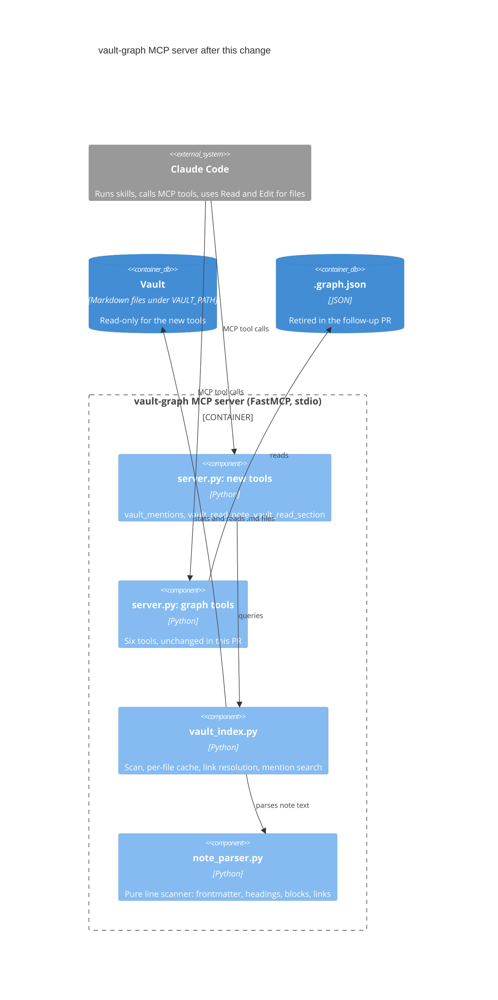

# Surgical vault search: mentions and section reads

> Spec for branch `surgical-search`. Status: **draft for review** (2026-10-18). Milestone: `v0.2` (see D11).
> Method: EARS requirements with RFC 2119 keywords, a C4 component view, and every requirement (R#)
> traced to a verification (V#). Implementation steps (S#) live in `tasks/todo.md`, one TDD slice per
> test, each naming the R# it satisfies.

## 1. Context

### Problem

Vault work in loremaester reads Markdown notes whole, which fills the context window. Three causes:

1. No vault tool returns note content. `vault_backlinks` returns names and paths only, and the graph
   index (`.graph.json`) keeps link targets without lines, headings or text.
2. The skills prescribe whole reads: worldbuilding follows wikilinks "1-2 levels deep", chronik reads
   "every sub-file" of a session folder and every referenced NPC note, and the vault CLAUDE.md template
   says to Grep for backlinks and Read to traverse.
3. `vault-scout` works around it by sending the reading to a Haiku subagent, which moves the cost
   instead of removing it.

### Goal

Give Claude Obsidian-style **linked and unlinked mentions** (the block around each mention, grouped by
note) and **section reads**, so skills pull only the parts of notes they need. Whole reads become the
last resort.

The workflows that hurt: (a) worldbuilding research around hub notes, and (b) chronik and session prep
reading linked notes. Ad-hoc lookups (c) work well today and keep their freedom.

### Baseline

Measured read-only on a real 469-note campaign vault (backup snapshot, its two skip folders applied,
tokens estimated as characters divided by 4, block model approximated by a script):

| Measure | Value |
|---|---|
| Note size | median ~680 tokens; 77% under 2k; largest ~22k (player notes with a single heading) |
| Biggest hub (76 linking notes) | ~217k tokens read whole; ~18.5k for every excerpt; ~1k for a map of every mention |
| Linked mentions per note | 304 of 334 linked notes (91%) fit all their excerpts in 4k tokens; 9 need more than 8k |
| Unlinked mentions | heavier: ~49k tokens of excerpts for each of the top two hubs |
| Notes linked from each of the 5 latest session folders | 8 to 55 notes; 19k to 134k tokens read whole; 3 to 6x less when small notes are read whole and large ones as an outline plus one section |
| Cold parse of the whole vault | about 0.4 s |

The same survey found defects in the graph tools, handled outside this spec (section 9): backlinks are
listed once per link instead of once per note, exact file-name matching misses 68 links that Obsidian
resolves, 4 file names occur twice, and the index was 22 notes behind the vault.

### Success criteria

- **SC1** No mention is hidden: every `vault_mentions` response accounts for every matching mention,
  as an excerpt or in the map.
- **SC2** On the measured vault, the first `vault_mentions` call for the biggest hub stays near 5k
  tokens, and about 9 in 10 linked notes fit all their linked mentions in one call at the default budget.
- **SC3** In a side-by-side run of the same chronik or session-prep task, the new skills use at least
  3x less context than the old ones, and the GM judges the result at least as good.

## 2. Tier

**Heavy.** A new subsystem (a parser and an index behind three new MCP tools) plus behavior changes in
four skills.

## 3. Decisions

| # | Decision | Outcome | Why |
|---|---|---|---|
| D1 | Scope | Linked and unlinked mentions, plus note and section reads. No previews of linked notes, no write tools. | The cost is in reading; edits stay visible diffs through Edit. |
| D2 | Excerpt unit | The Markdown block holding the mention, labelled `path:line › heading path` | Mirrors Obsidian's Linked Mentions; keeps a list item's sub-items and a table's header. |
| D3 | Large results | The budget limits excerpt text only; a map lists every other mention; `paths` pulls chosen folders or notes | Nothing is lost by design, and Claude pulls only what it needs. |
| D4 | Unlinked matching | Title and aliases, case-insensitive whole words, optional configured endings | Obsidian behavior, plus inflected languages through a setting; the default stays generic. |
| D5 | Ordering | Folders take turns; reverse natural path order inside a folder | Breadth first; numbered or dated sessions come newest first without special folder names. |
| D6 | Index | A live per-file cache for the new tools; the graph tools move in a follow-up PR | No rebuild step and never stale; lets the follow-up retire `vault_rebuild_graph`. |
| D7 | Parser | Our own line scanner, no new dependency | The block model is line-based, and vault notes rarely need full CommonMark. |
| D8 | Read policy | A read ladder in the skills; whole reads only for named exceptions; no enforcing hook | The skills drive the costly workflows; ad-hoc use keeps its freedom. |
| D9 | `vault_read_note` | Whole under ~2k tokens, outline above | For a small note, an outline plus a section costs about as much as the note; Claude never guesses sizes. |
| D10 | Skills | Repo skills change here, in generic English; the maintainer's personal copies are compared side by side after merge | Release files stay generic; the behavior is verified on real prep. |
| D11 | Milestone | `v0.2`, amending locked decision Q1 (security plus backlog) by this one feature | v0.2 has not started, and the follow-up removes `vault_rebuild_graph` instead of gating it (SEC-5). |

## 4. Architecture

### 4.1 Component view (C4 level 3)



### 4.2 Components

| Component | Exposes | Depends on | Requirements |
|---|---|---|---|
| `note_parser.py` (new) | `parse_note(text)`: frontmatter, aliases, headings, code spans, links with lines; block, section and heading path for a line | Standard library, PyYAML (already in `requirements.txt`) | R16-R31 |
| `vault_index.py` (new) | `VaultIndex`: refresh, resolve, linked and unlinked mentions | `note_parser.py`, the file system (read-only) | R1-R12, R14, R32-R38, R48-R53 |
| `server.py` (changed) | The three new MCP tools; the six graph tools unchanged | `vault_index.py` | R13, R15, R39-R47, R54-R75 |
| Skills, examples, docs (changed) | The read ladder and the tool reference | The three tools | R76-R83 |

### 4.3 Data flow of `vault_mentions`

1. Refresh: stat every `.md` file, re-parse added or changed notes, drop deleted ones.
2. Resolve the `note` argument, or treat the name as an unwritten note.
3. Collect mentions: links that resolve to the note, or plain-text matches in unlinked mode.
4. Build the block for each mention, merge overlapping blocks per note, and label them.
5. Order the notes: folders take turns, reverse natural order inside a folder.
6. Fill excerpts up to the budget; put every other mention in the map.
7. Format Markdown: overview, excerpts, map, pull hints.

### 4.4 Configuration

| Variable | Default | Meaning |
|---|---|---|
| `VAULT_PATH` | `/workspace/vault` | Vault root (existing). |
| `VAULT_SKIP_FOLDERS` | empty | Comma-separated vault-relative folders whose notes are not listed as mention sources. They are still counted in the overview and reachable through `paths`. |
| `VAULT_NAME_ENDINGS` | empty | Comma-separated suffixes for unlinked matching, for example `s,es,n,en,e,er,ern` for German. |

## 5. Tool contracts

All three tools take `note` the way a link names a note (section 6.5) and return Markdown. They name the
vault root once and show every other path relative to it, so Claude can turn `path:line` into a `Read`
with offset and limit.

### 5.1 `vault_mentions(note, unlinked=False, paths=None, budget_tokens=4000)`

```text
## Linked mentions: Captain Aldric (NPCs/Captain Aldric.md)
Vault: /path/to/vault
76 notes link here: Sessions 31 · Locations 23 · NPCs 19 · (root) 3
Unlinked: 64 notes name it without a link
Skipped folders: Rules 2
Excerpts for 17 notes (~4.0k of ~18.5k tokens for all)

Sessions/Session 36/Prep.md:42 › Scenes › Arrival
- The party meets [[Captain Aldric]] at the north gate.
  - He asks about the missing patrol.

Locations/North Gate.md:9 › Residents
| Name | Role |
|---|---|
| [[Captain Aldric]] | Gate captain |

...

Not excerpted, pull with paths=[...]:
Sessions (24): Session 12/Log.md L40,88 · Session 11/Prep.md L7 · ...
Locations (19): Old Mill.md L12 · Ferry.md L3,19 · ...
More: paths=["<folder or note>"] · budget_tokens=<n> · unlinked=true
```

### 5.2 `vault_read_note(note)`

A note under ~2k tokens comes back whole:

```text
## NPCs/Mira.md (~640 tokens, whole)
Vault: /path/to/vault
---
type: npc
...
```

A larger note comes back as an outline (heading ranges include their subsections):

```text
## Outline: NPCs/Captain Aldric.md (212 lines, ~3.1k tokens)
Vault: /path/to/vault
Frontmatter, L1-8:
  type: npc
  aliases: [Aldric, the Captain]
Headings:
  L10-212   # Captain Aldric    ~3.0k
  L25-60    ## Background       ~0.9k
  L61-140   ## Relationships    ~1.4k
  L95-140     ### Rivals        ~0.6k
  L141-212  ## GM Notes         ~1.0k
```

A large note without sections to pick from says so:

```text
## Outline: Players/Notes.md (900 lines, ~22.4k tokens)
Vault: /path/to/vault
No sections to pick from (one heading).
For specific names: vault_mentions("<name>", paths=["Players/Notes.md"])
For all of it: Read the file.
```

### 5.3 `vault_read_section(note, headings)`

```text
## NPCs/Captain Aldric.md:61-140 › Captain Aldric › Relationships (~1.4k tokens)
Vault: /path/to/vault
## Relationships
...
```

### 5.4 The read ladder

| Need | Step |
|---|---|
| What does the vault say about X? | `vault_mentions` |
| What is X? | `vault_read_note` |
| Which part of X? | `vault_read_section` |
| All of X | A whole `Read`, only for the exceptions below |

Exceptions where a whole `Read` is right: unstructured source material the task is about (for example
player notes without sections, which chronik treats as the source of truth), and a note rewritten from
scratch. Edits read only the lines being changed: Claude Code accepts an Edit after a partial Read.

Skill changes:

- **worldbuilding**: the primary note through `vault_read_note`; linked notes through `vault_read_note`
  and sections instead of reading one or two link levels whole; `vault_mentions` instead of grepping for
  `[[Topic Name]]`. The grep for plain-text frontmatter fields stays.
- **chronik**: player notes whole (the exception). For each NPC they name,
  `vault_mentions(npc, paths=["Sessions/Session N"])` for what that session's prep says about them, and
  `vault_read_note(npc)` for who they are. Prep files through `vault_read_note` and sections.
- **session-creation**: `vault_read_section(session, ["Log", "Open Threads"])` for recent sessions;
  `vault_mentions` for active NPCs, locations and factions.
- **vault-scout**: Example 3 uses `vault_mentions`; the tool list gains the three tools; mentions and
  sections of one note are no longer a reason to dispatch.

## 6. Requirements

"Listed notes" are the notes a `vault_mentions` call may list: not in a skipped folder (unless a `paths`
entry names it) and inside `paths` when given. Token estimates are characters divided by 4.

### 6.1 Configuration

- **R1** The new tools SHALL use the vault root from `VAULT_PATH`, defaulting to `/workspace/vault` like
  the graph tools.
- **R2** Where `VAULT_SKIP_FOLDERS` names folders, `vault_mentions` SHALL NOT list mentions from notes
  inside them.
- **R3** When a `paths` entry names a skipped folder or a note inside one, `vault_mentions` SHALL list
  mentions from it.
- **R4** `vault_read_note` and `vault_read_section` SHALL open notes inside skipped folders.
- **R5** Where `VAULT_NAME_ENDINGS` lists suffixes, unlinked matching SHALL also match a term followed by
  exactly one of them.
- **R6** While `VAULT_SKIP_FOLDERS` and `VAULT_NAME_ENDINGS` are unset or empty, the server SHALL skip no
  folder and match no ending.

### 6.2 Index, safety and output

- **R7** The index SHALL include every `.md` file under the vault root except files with a path segment
  that starts with `.` (such as `.obsidian` and `.trash`).
- **R8** If a file's real path lies outside the vault root, then the index SHALL NOT read it.
- **R9** When a new tool is called, the index SHALL reflect every note added, changed (modification time
  or size) or deleted since the previous call.
- **R10** The index SHALL NOT re-read a note whose modification time and size are unchanged.
- **R11** The index SHALL decode notes as UTF-8, replacing invalid bytes.
- **R12** The tools SHALL match `note` and `paths` arguments against the scanned notes and SHALL NOT open
  a path built from an argument.
- **R13** The new tools SHALL NOT create, modify or delete any file.
- **R14** The new tools SHALL work when `.graph.json` is missing.
- **R15** Every response of the new tools SHALL name the vault root once and show all other paths
  relative to it.

### 6.3 Parsing

- **R16** Where a note's first line is `---`, the parser SHALL treat the lines up to the next `---` line
  as frontmatter.
- **R17** If the frontmatter is not valid YAML, then the parser SHALL keep its text and report no
  aliases.
- **R18** The parser SHALL read aliases from the frontmatter key `aliases`, given as a list or a single
  string.
- **R19** The parser SHALL recognize only `#` headings (levels 1 to 6) outside code and frontmatter;
  underlined (setext) headings stay plain text.
- **R20** The parser SHALL find no links and no unlinked mentions inside fenced code blocks (opened by
  three backticks or `~~~`) or inline code.
- **R21** The parser SHALL recognize `[[target]]`, `[[target|text]]`, `[[target#heading]]`,
  `[[target#^block]]` and `![[target]]` as links to `target`, in the body and in frontmatter values.
- **R22** The parser SHALL NOT count as links: `[[#heading]]` links within a note, links whose target
  has a file extension other than `.md`, and Markdown-style `[text](path)` links.

### 6.4 Blocks and sections

- **R23** For a mention in a paragraph, the block SHALL be the run of adjacent non-blank lines that are
  not headings, list items, table rows, quote lines, fences or thematic breaks.
- **R24** For a mention in a list item, the block SHALL be the item plus the run of following lines
  indented deeper than it (a tab counts as four columns), ending at the first blank line or the first
  line that is not indented deeper.
- **R25** For a mention in a nested list item, the block SHALL also include the first line of each
  ancestor item.
- **R26** For a mention in a table row, the block SHALL be the table's first row, its separator row if
  present, and the mentioning row.
- **R27** For a mention in a callout or blockquote, the block SHALL be the whole run of adjacent `>`
  lines.
- **R28** For a mention in a heading, the block SHALL be that heading's section.
- **R29** For a mention in frontmatter, the block SHALL be the property: its key line plus its indented
  or list continuation lines.
- **R30** A section SHALL run from its heading to the line before the next heading of the same or higher
  level, or to the end of the note.
- **R31** The heading path of a block SHALL be the chain of headings enclosing its first line, joined by
  ` › `.

### 6.5 Link resolution

- **R32** The index SHALL compare link targets and `note` arguments with notes after Unicode NFC
  normalization and lowercasing, ignoring surrounding whitespace and a trailing `.md`.
- **R33** A target without `/` SHALL match notes by file name without `.md`.
- **R34** A target with `/` SHALL match the vault-relative path from the root, or else the end of a path
  at a folder boundary.
- **R35** When several notes match a link target, the index SHALL pick the one in the linking note's
  folder, else the one with the fewest path segments, else the alphabetically first path.
- **R36** When several notes match a `note` argument, the tool SHALL pick the one with the fewest path
  segments, else the alphabetically first path.
- **R37** When several notes match a `note` argument, the response SHALL name the other matches.
- **R38** When no note matches a link target, the index SHALL record the link as a mention of an
  unwritten note named by the normalized target.

### 6.6 `vault_mentions`: linked mode

- **R39** `vault_mentions` SHALL list every link in a listed note that resolves to the requested note.
- **R40** When the requested name matches no note, `vault_mentions` SHALL list the links recorded for
  that unwritten note.
- **R41** `vault_mentions` SHALL NOT list a note's links to itself.
- **R42** Each excerpt SHALL show its block under the label `path:line › heading path`, where `line` is
  the 1-based line of the excerpt's first mention.
- **R43** Blocks of one note that share a line SHALL appear as one excerpt.
- **R44** If an excerpt exceeds 1,500 characters, then the tool SHALL cut it at the last line end within
  the limit (mid-line if its first line is longer) and add a marker naming the block's last line.
- **R45** The response SHALL open with an overview: the note's path (or "no note yet"), the count of
  listed notes with mentions per top-level folder, and the count of listed notes with mentions of the
  other kind (unlinked in linked mode, linked in unlinked mode).
- **R46** Where skipped folders hold mentions that are not listed, the overview SHALL give the count of
  mentioning notes per skipped folder.
- **R47** The overview SHALL state how many notes have excerpts, and the estimated tokens shown against
  the estimated tokens of all excerpts.

### 6.7 `vault_mentions`: unlinked mode

- **R48** When `unlinked` is true, `vault_mentions` SHALL list plain-text occurrences of the note's title
  or aliases in other notes instead of links.
- **R49** Unlinked matching SHALL be case-insensitive and match whole words only: no letter, digit or
  underscore of any script directly before or after the match.
- **R50** Unlinked matching SHALL ignore titles and aliases shorter than 3 characters.
- **R51** Unlinked matching SHALL search body text only, excluding frontmatter, code, wikilinks,
  Markdown links and URLs.
- **R52** In unlinked mode, `vault_mentions` SHALL NOT list a block that holds a link to the note.
- **R53** For an unwritten note, unlinked matching SHALL use the requested name as its only term.

### 6.8 Budget, map and paths

- **R54** Only excerpts and their labels SHALL count toward `budget_tokens` (default 4,000).
- **R55** The tool SHALL add each note's excerpts in listing order and stop at the first note whose
  excerpts would exceed the budget.
- **R56** The tool SHALL show at least one excerpt.
- **R57** If the first note's excerpts exceed the budget, then the tool SHALL show them in line order up
  to the budget.
- **R58** After the excerpts, the response SHALL list every mention not shown as an excerpt in a map:
  note path and mention line numbers, grouped by top-level folder.
- **R59** When the map is not empty, the response SHALL end with pull hints for `paths`, `budget_tokens`
  and the other mode.
- **R60** For any `budget_tokens` and `paths`, the excerpted and mapped mentions together SHALL equal all
  matching mentions in listed notes.
- **R61** Where `paths` is given, `vault_mentions` SHALL list only mentions from notes inside a named
  folder or equal to a named note (vault-relative, case-insensitive, whole path segments, `.md`
  optional).
- **R62** If a `paths` entry matches no note, then the response SHALL say so.

### 6.9 Ordering

- **R63** `vault_mentions` SHALL let top-level folders take turns, the folder with the most mentioning
  notes first, ties by folder name, with notes at the vault root forming their own folder.
- **R64** Within a folder, `vault_mentions` SHALL order notes by vault-relative path in reverse natural
  order, comparing digit runs as numbers.

### 6.10 `vault_read_note`

- **R65** If a note's estimated size is under 2,000 tokens, then `vault_read_note` SHALL return the note
  whole.
- **R66** If a note's estimated size is 2,000 tokens or more, then `vault_read_note` SHALL return an
  outline: path, line count, estimated tokens, the frontmatter verbatim (cut at 1,500 characters with a
  marker), and each heading with its level, line range including subsections, and estimated tokens.
- **R67** If an outlined note has fewer than two headings, then the outline SHALL say that sections
  cannot slice it and name `vault_mentions` with `paths` and a whole `Read` as the ways in.

### 6.11 `vault_read_section`

- **R68** `vault_read_section` SHALL accept one heading or a list of headings.
- **R69** `vault_read_section` SHALL match headings case-insensitively after trimming whitespace and `#`
  marks.
- **R70** `vault_read_section` SHALL return every matching section, each labelled with its path, line
  range and heading path.
- **R71** `vault_read_section` SHALL NOT truncate a matching section.
- **R72** If a requested heading matches no section, then the response SHALL list the note's headings.

### 6.12 Errors

- **R73** If `vault_read_note` or `vault_read_section` receives a `note` that matches no note, then it
  SHALL return an error naming up to five close titles or aliases.
- **R74** If `vault_mentions` receives a name that matches no note, then the response SHALL name up to
  five close titles or aliases.
- **R75** If the vault root is missing or not a folder, then each new tool SHALL return an error naming
  the path.

### 6.13 Skills, tool descriptions and docs

- **R76** The worldbuilding, chronik, session-creation and vault-scout skills SHALL route vault reading
  through the read ladder in 5.4.
- **R77** The skills SHALL reserve a whole-file `Read` for the exceptions in 5.4.
- **R78** The skills SHALL direct edits to `Read` only the lines being changed.
- **R79** The skill copies under `examples/ttrpg/skills/` SHALL stay byte-identical to `skills/`.
- **R80** Release files changed by this work SHALL contain no personal campaign names and no non-English
  prose.
- **R81** The new tools' descriptions SHALL say what each tool returns without forbidding `Read`.
- **R82** The vault CLAUDE.md example and template SHALL point to the new tools for mentions and large
  notes without forbidding `Read`.
- **R83** `docs/mcp-tools.md`, `README.md`, `docs/quickstart.md`, `CHANGELOG.md` and `docs/design.md`
  SHALL document the three tools, the two new settings and the tool count of 17.

## 7. Verification

| V# | Method | Covers | Check |
|---|---|---|---|
| V1 | TEST | R1-R75 | At least one pytest test per requirement, named `test_r<NN>_<behavior>`, in `test_note_parser.py`, `test_vault_index.py` and `test_vault_tools.py` under `mcp-servers/vault-graph/`, run against a small fictional fixture vault built in `tmp_path`. A check lists any requirement in this range without a test. |
| V2 | INSPECT | R76-R83 | `cmp` each changed skill against its `examples/ttrpg/skills/` copy; grep the changed release files for non-ASCII letters and campaign names (no output expected); review the ladder wording in each skill and in the template; confirm the tool count of 17 in the docs. |
| V3 | GATE | All | Full `pytest`, `ruff check .` and `ruff format --check .` pass, as in CI. |
| V4 | MEASURE | SC1, SC2 | Run the real tools on the measured vault snapshot: first-call size for the biggest hub; share of linked notes whose complete answer fits one call; excerpted plus mapped mentions equal all mentions for the top 10 hubs; cold parse time. Report counts and sizes only. |
| V5 | USER | SC3 | After merge, the GM runs the same chronik or prep task with the old and the new personal skill copies, compares context use (`/context`) and judges the output. |

The fixture vault is fictional and in English. It covers every block type; nested lists indented with
tabs; tables; callouts; links in headings and frontmatter; aliases as a list and as a string; invalid
YAML; an underlined heading; links inside fenced and inline code; two notes with the same name;
path-qualified, differently cased and `.md`-suffixed links; links to unwritten notes; embeds;
`#heading` and `#^block` links; attachment links; Markdown-style links; self-links; numbered session
folders (`Session 9`, `Session 10`); a skipped folder; a symlink out of the vault (created by the test);
a note name in both NFC and NFD form (`Café`); and large notes with and without headings.

## 8. Out of scope

- The graph tools, `.graph.json` and `vault_rebuild_graph` (follow-up PR, section 9).
- The duplicate-backlink fix in the graph builder, and the CI ruff pin (separate PRs, section 9).
- A hook that enforces the read ladder.
- Previews of linked notes, and any tool that writes.
- Markdown-style links, setext headings, indented code blocks, and resolving `#^block` links to the
  block itself (they count as links to the note).
- The maintainer's personal skill copies and MCP config (after merge, outside the repo).

## 9. Rollout

1. **`ci-ruff-pin`** (first): pin ruff in `requirements-dev.txt` and apply its formatting to the Python
   block in `specs/v0.2/v0.2-milestone-plan.md`. Without it, every PR fails `ruff format --check`,
   because the newest ruff formats Python code blocks inside Markdown.
2. **`fix-duplicate-backlinks`**: list each backlink once in `scripts/build_vault_graph.py`, with a test.
   This fixes `vault_backlinks` and the inflated ranking in `vault_central_notes` for the current release.
3. **`surgical-search`** (this spec): parser, index, the three tools, skills and docs. The PR adds this
   item to `v0.2-milestone-plan.md` and gets its own issue in milestone `v0.2`.
4. **Follow-up**: the graph tools move onto `vault_index.py`, and `.graph.json` and `vault_rebuild_graph`
   are retired. This settles vault-graph's half of SEC-5 (#30).

After step 3 merges, the maintainer sets `VAULT_SKIP_FOLDERS` and `VAULT_NAME_ENDINGS` in the MCP
config, makes side-by-side copies of the personal skills, updates the vault's own CLAUDE.md, and runs V5.
